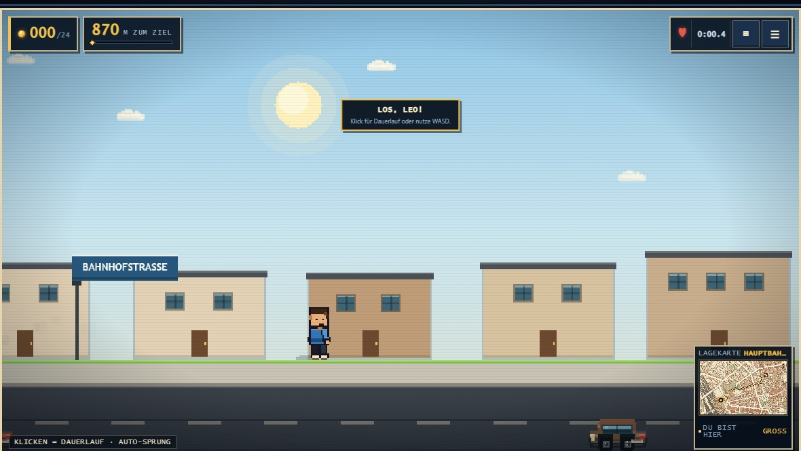
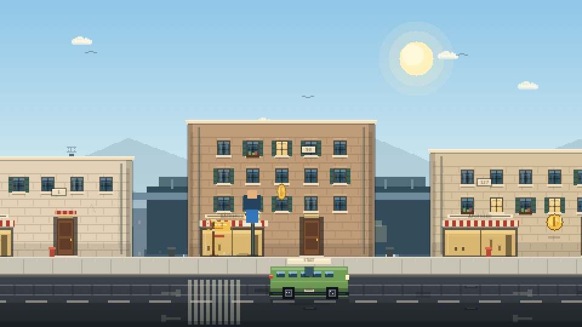

# Auf nach Augsburg — Street Run

Ein pixeliger Browser-Stadtlauf **durch die echten Straßen von Augsburg**.
Vom Hauptbahnhof über Königsplatz, Rathaus, Dom und Fuggerei bis zu den
Lechkanälen, dem Zeughaus und dem Sheridan-Park.

Die Etappen und Karten werden aus echten OpenStreetMap-Gebäuden und
OSRM-Fußrouten gebaut. Die Runner-Version (`index.html`) braucht keine
Musikdateien, keinen Google-Maps-Schlüssel und kein Backend — der
Chiptune-Soundtrack und alle Soundeffekte werden komplett im Browser
synthetisiert. Jede Etappe hat eine eigene Straßenszene, eigene Farben, eigene
Musik und eigenen Verkehr.

Die Straße hat in **jeder** Etappe drei durchgehende Bänder: **BÜRGERSTEIG**,
**STRASSENBAHN** und **STRASSE**. Auf dem Gehweg laufen Passanten, Radler und
Tauben. Daneben liegt das echte Gleisbett mit Schotter, Schwellen, zwei
Schienen, Oberleitungsmasten und Fahrdraht — dort fährt **nur die
Straßenbahn**, in Laufrichtung. Ganz unten rollt der Autoverkehr im
Gegenverkehr. Dazwischen stehen Marktstände in den Lücken zwischen den
Häusern, Ladenausleger und Straßenschilder — kein Bahndamm, keine DB-Kulisse.

**Der Junge bleibt auf dem Gehweg.** Straßenbahn und Autos fahren auf ihren
eigenen Bändern im Vordergrund durch. Es gibt keinen automatischen Spurwechsel
und keine Spurtaste. Mit **S/↓** duckt sich der Junge am Boden unter hohen
Hindernissen durch. Der Spieler entscheidet über Timing, Sprung und Tempo.





## Spielen

Direkt im Browser: **<https://tegmaram.github.io/auf-nach-augsburg-street-run/>**
(ausgeliefert über GitHub Pages, Workflow `.github/workflows/pages.yml`).

## Lokal starten

Im Ordner `aufnachaugsburg`:

```powershell
python -m http.server 8090 --bind 127.0.0.1
```

Danach <http://localhost:8090/> öffnen. Alternativ `start.bat` im
Projektordner doppelklicken: der Server startet dann auf allen
Netzwerkadressen und der Browser öffnet sich automatisch.

## Steuerung

| Eingabe | Aktion |
| --- | --- |
| `A` / `D` oder `←` / `→` | Laufen |
| `W` / `Leertaste` / `↑` | Springen |
| `Shift` | Rennen |
| Klick oder Tap ins Spiel | Dauerlauf starten |
| `M` | Stadtplan öffnen |
| `P` / `Esc` | Pause |

Auf Touch-Geräten erscheinen zusätzliche Lauf- und Sprungbuttons. Der Junge
läuft fest auf dem Gehweg; Straßenbahn und Autos bleiben Kulisse.

## Drei aktive Straßenzüge (recherchierte Kulisse)

Jede Etappe zeigt reale Augsburger Bauwerke entlang ihrer Route — als ferne
Skyline und als Sehenswürdigkeit mit Namenstafel direkt am Straßenrand:

1. **Hauptbahnhof** (870 m, Bahnhofstraße): Empfangsgebäude von **1845**
   (Eduard Rüber, ältestes noch betriebenes Großstadtbahnhofsgebäude
   Deutschlands), die Prachtstraße **Bahnhofstraße** (1869 angelegt), die
   **Große Synagoge** an der Halderstraße (1913–17, Jugendstil mit Kuppel) und
   der **Königsplatz** mit dem Warte-Pavillon „Pilz“ (Otto Holzer, 1913/14) und
   dem **Thormann-Brunnen** von 1880.
2. **Königsplatz → Maximilianstraße** (1.020 m): die seit 1869 so benannte
   Platzanlage, das **Schaezlerpalais** (Rokoko, 1765), der **Merkurbrunnen**
   (1596–99) und der **Herkulesbrunnen** (1602).
3. **Rathaus & Perlachturm** (1.700 m, Rathausplatz): das **Rathaus** von Elias
   Holl (1615–20), der **Perlachturm** (70,4 m), der **Augustusbrunnen** (1594)
   und der **Elias-Holl-Obelisk** von 1968. (Der Obelisk steht am Rathausplatz,
   nicht auf dem Königsplatz.)

Die drei Etappen schalten sich nacheinander frei. Danach folgt der
**Endlos-Modus**. Jede Etappe hat eine Zielzeit und drei Sterne: Zielzeit,
alle Münzen, keine Treffer. Bestzeiten, Sterne und Fortschritt bleiben lokal
im Browser.

Die Etappen 4–8 (Dom, Fuggerei, Lechkanäle, Zeughaus, Sheridan-Park) sind
weiterhin vollständig in `levels.js`/`levels.json` enthalten, aber in der
Auswahl ausgeblendet. Sie lassen sich später mit
`AUGSBURG_ACTIVE_LEVEL_COUNT` in `js/runner/street.js` wieder aktivieren.

## Was drin ist

- Durchgehende Straße statt Dachparkour: **drei Bänder** (Gehweg,
  Straßenbahn-Gleis, Straße) mit Bordsteinkante, Mittelstreifen,
  Richtungspfeilen, Gullydeckeln, Laternen, Ampeln, Straßenschildern,
  Wartehäuschen, Marktständen, Ladenauslegern und Fußgängerüberweg
- **Straßenbahn-Linie** als eigenes Gleisbett: Schotter, Schwellen alle zwölf
  Pixel, zwei Stahlschienen, Oberleitungsmasten und durchgehender Fahrdraht.
  Auf diesem Band fahren ausschließlich Straßenbahnen
- sechs detaillierte Fahrzeugtypen im Verkehr: Taxi, Bus, Straßenbahn, Van,
  Limousine und Polizei mit Radkästen, Fenstern, Spiegeln, Stoßstangen und
  Leuchten. Sie fahren durch, statt hin und her zu pendeln; die Straßenbahn
  bleibt auf ihrem Gleis, Autos auf ihrer Spur. Die Straßenbahn fährt deutlich
  schneller und damit realistischer als zuvor
- **Tag-Nacht-Zyklus**: Sonne und Mond ziehen über den Himmel, Sterne kommen
  heraus, der Himmel wechselt von Tag über Abendrot zu Nacht. Bei Dunkelheit
  leuchten Hausfenster, Straßenlaternen und Fahrzeuglichter
- **Reduzierter Charakter mit Swag**: kein Rucksack mehr, dafür rückwärts
  getragene Cap, Sonnenbrille, Goldkette und Sneaker; neue Idle-Geste an der
  Cap und eine schwungvollere Laufanimation
- **Gedeckte Hausbeschilderung**: Ladenausleger, Markisen und Türschilder
  nutzen Grün-, Blau- und Ockertöne statt roter Schilder
- **Ducken**: mit **S/↓** wird der Junge am Boden kleiner. Tief fliegende
  Tauben kommen auf Kopfhöhe: Wer steht, wird getroffen; wer sich duckt,
  kommt durch. Auf Touch-Geräten gibt es einen eigenen DUCKEN-Button.
- **Ein Herz**: Ein Treffer beendet den Lauf. Der Junge wirbelt in einer
  kurzen Todesanimation durch die Luft und das Herz leert sich. Mit
  Checkpoint geht es am letzten Zwischenziel weiter, ohne Checkpoint startet
  die Etappe komplett von vorn (Zeit, Münzen und Fortschritt werden
  zurückgesetzt)
- acht vorbereitete Straßenszenen mit eigener Skyline, eigenem Belag, eigener
  Wetterstimmung und eigener Musik — aktiv sind die ersten drei
- Fahrräder, Fußgänger, E-Scooter-Kids und Tauben als Hindernisse; die meisten
  laufen oder fahren einfach durch, nur wenige pendeln
- Münzen auf dem Gehweg, Etappensterne, Bestzeiten und Endlos-Rekord
- sanfterer Chiptune-Soundtrack mit acht Tracks, dynamischer Intensität, Hall,
  Echo, Kompressor und Live-Synthese ohne Musikdateien
- HUD, Live-Minimap, große Karte, Pause-, Sieg- und Hilfedialoge
- **Augsburger Straßenleben**: Marktstände mit Obst, Blumen, Brot und Käse,
  Ladenausleger, Cafétische, Straßenschilder und Sehenswürdigkeiten
- **Bildschirmanpassung für jedes Gerät**: die Bühne passt sich an Fenster,
  Hoch- und Querformat, Tablets und Vollbild an; die Leinwand skaliert in
  ganzen Vielfachen der Gerätepixel (bis 3×) und bleibt dadurch scharf
- responsives Layout, Touch-Steuerung, Tastaturfokus und
  `prefers-reduced-motion`

## Projektstruktur

```text
aufnachaugsburg/
  index.html                  Runner-Version
  classic.html                ältere Version auf der Mario-Engine
  css/runner.css              UI, Etappenauswahl, HUD, Dialoge
  js/runner/audio.js          Chiptune-Soundtrack und Soundeffekte
  js/runner/game.js           Canvas-Runner: Spuren, Verkehr, Physik
  js/runner/street.js         baut die drei Spuren und verteilt die Münzen
  js/runner/browser.js        Etappenauswahl
  js/runner/store.js          Freischaltung, Bestzeiten, localStorage
  js/runner/data/levels.js    generierte Etappendaten
  assets/maps/*.png           pixelierte OpenStreetMap-Karten
  sprites/*.png               Spieler, Autos, Wappen
  tools/build_world.py        OSM/OSRM-Abruf und Level-Generator
  tools/check_project.py      statische Projektprüfung
  tools/smoke_test.py         Headless-Abnahmetest
```

## Tests

```powershell
cd aufnachaugsburg
python tools/check_project.py
python tools/smoke_test.py
```

## Herkunft und Lizenzen

- Engine-Grundlage: [reruns/mario](https://github.com/reruns/mario) von
  Garrett Johnson, MIT-Lizenz (Code).
- Die Mario-Sprites und -Sounds in `classic.html` (`sprites/`, `tiles*`,
  `sounds/*.wav`) sind Nintendo-IP; die MIT-Lizenz des Codes macht die
  enthaltenen Grafiken und Sounds **nicht** zu freiem Material. Für eine
  Veröffentlichung muss der Klassiker-Modus entfernt oder mit eigenem Material
  neu bestückt werden — die Runner-Version (`index.html`) ist davon
  unabhängig, sie zeichnet alles selbst.
- Gebäude, Straßen und Grünflächen: © OpenStreetMap-Mitwirkende, Daten unter
  der [Open Database License](https://www.openstreetmap.org/copyright).
- Fußrouten: [OSRM](http://project-osrm.org/) auf Basis von
  OpenStreetMap-Daten.
- Stadtwappen Augsburg: amtliches Werk / gemeinfrei, Quelle
  [Wikimedia Commons](https://commons.wikimedia.org/wiki/File:DEU_Augsburg_stylized_COA.svg).
- Nicht-kommerzielles Fan-Projekt ohne Verbindung zu Nintendo, OpenStreetMap,
  OSRM, Google oder der Stadt Augsburg.
