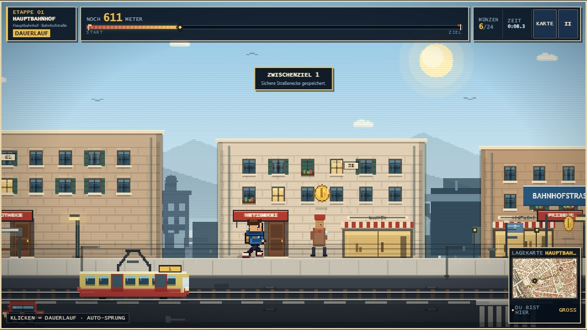
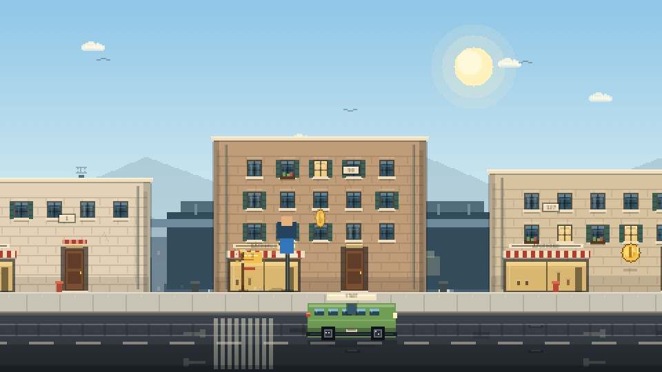

# Auf nach Augsburg — Street Run

Ein kleiner Browser-Platformer durch die echten Straßen von Augsburg. Drei
aktive Etappen führen vom Hauptbahnhof über den Königsplatz bis zu Rathaus und
Perlachturm. Gebäude, Straßen und Karten stammen aus OpenStreetMap, die
Fußrouten von OSRM.

Kein Mario, kein Google-Schlüssel, kein Backend. Dafür ein Hoodie, ein gelber
Kadett, Münzen, Straßenbahnen, Taxis, Busse, Fahrräder, E-Scooter-Kids,
Tauben und acht eigene Chiptune-Tracks direkt aus dem Browser.





## Spielen

Am einfachsten `index.html` direkt im Browser öffnen. Alternativ:

```powershell
python -m http.server 8090
```

Danach <http://localhost:8090/> öffnen. `start.bat` startet den Server und
öffnet den Browser automatisch. Die ältere Version auf Basis der klassischen
Mario-Engine liegt unter `classic.html`.

## Steuerung

| Eingabe | Aktion |
| --- | --- |
| `A` / `D` oder `←` / `→` | Laufen |
| `W` / `Leertaste` / `↑` | Springen |
| `Shift` | Rennen |
| Klick oder Tap ins Spiel | Dauerlauf starten |
| `M` | Große Karte öffnen |
| `P` / `Esc` | Pause |

Kurz getippte Sprünge sind kleine Hüpfer, länger gehaltene Sprünge gehen
weiter. Auf Touch-Geräten erscheinen zusätzliche Buttons. Musik und Ton lassen
sich getrennt schalten. Ein Sturz bringt dich zur letzten sicheren
Straßenecke zurück.

## Drei aktive Etappen

| # | Ort | Stufe | Strecke | Häuser | Münzen | Hindernisse |
| --- | --- | ---: | ---: | ---: | ---: | --- |
| 1 | Hauptbahnhof | 1 | 870 m | 21 | 24 | Fahrräder, E-Scooter, Fußgänger |
| 2 | Königsplatz | 2 | 1020 m | 29 | 25 | + Tauben |
| 3 | Rathaus & Perlachturm | 3 | 1700 m | 31 | 27 | + dichterer Verkehr |

Die drei Etappen werden nacheinander freigeschaltet. Danach folgt der
**Endlos-Modus**. Jede Etappe hat eine Zielzeit und drei Sterne: Zielzeit,
alle Münzen, keine Treffer. Bestzeiten, Sterne, Freischaltungen und der
Endlos-Rekord bleiben lokal im Browser.

Die Etappen 4–8 (Dom, Fuggerei, Lechkanäle, Zeughaus, Sheridan-Park) bleiben
vollständig in `data/levels.js` und `data/levels.json` erhalten, sind aber
ausgeblendet. Mit `AUGSBURG_ACTIVE_LEVEL_COUNT` in `js/runner/street.js`
lassen sie sich später wieder einschalten.

## Was drin ist

- **Drei Bänder**: **Bürgersteig**, **Straßenbahn** (Gleisbett mit Schotter,
  Schwellen, zwei Schienen, Oberleitungsmasten und Fahrdraht) und **Straße**
  (Gegenverkehr) laufen in jeder Etappe durch. Auf dem Gleis fährt nur die
  Straßenbahn, auf der Straße nur der Autoverkehr. Der Junge bleibt auf dem
  Gehweg; es gibt keinen automatischen Spurwechsel und keine Spurtaste.
  Fassaden oberhalb der Laufebene, Bordsteine, Mittelstreifen,
  Richtungspfeile, Gullys, Straßenschilder, Laternen, Ampeln, Marktstände
  und Ladenausleger.
- **Jedes Gerät**: Die Bühne passt sich an Fenstergröße, Hoch-/Querformat und
  Vollbild an, die Leinwand skaliert in ganzen Gerätepixel-Vielfachen (bis 3×).
- **Recherchierte Kulisse**: Jede Etappe zeigt reale Bauten ihrer Route —
  Hauptbahnhof (1845), Bahnhofstraße, Große Synagoge (1913–17), Königsplatz mit
  „Pilz“ und Thormann-Brunnen (1880), Schaezlerpalais (1765), Merkur- (1596–99)
  und Herkulesbrunnen (1602), Rathaus (1615–20), Perlachturm (70,4 m),
  Augustusbrunnen (1594) und der Elias-Holl-Obelisk. Wichtige Stationen stehen
  zusätzlich mit Namenstafel am Straßenrand.
- **Verkehr, der durchfährt**: Taxi, Bus, Straßenbahn, Van, Limousine und
  Polizei fahren auf ihren Bändern vorbei, statt hin und her zu pendeln. Die
  Straßenbahn bleibt auf dem Gleis, Autos auf der Straße. Die Fahrzeuge haben
  Radkästen, Fenster, Spiegel, Stoßstangen und Leuchten.
- **Ducken**: Mit **S/↓** wird der Junge am Boden kleiner und kommt unter
  Tauben und hohen Hindernissen durch. Auf Touch-Geräten gibt es dafür einen
  eigenen DUCKEN-Button.
- **Hindernisse auf dem Gehweg**: Fahrräder, E-Scooter, Fußgänger und Tauben.
  Die meisten fahren oder laufen einfach durch; nur wenige pendeln an einem
  Platz. Draufspringen federt dich hoch, seitliche Treffer bremsen dich aus.
- **Münzen statt Zirbelnüssen**: goldene Münzen zum Sammeln, auch hoch über
  der Straße.
- **Sanfterer Soundtrack**: acht Chiptune-Tracks mit Bass, Lead, Pad,
  Arpeggio, Schlagzeug, Hall, Echo und Kompressor. Die Intensität steigt mit
  dem Fortschritt. Keine Musikdateien.
- **Echte Karten**: Gebäude, Straßen, Wasser, Grünflächen und Gleise aus
  OpenStreetMap als 512 × 320-Pixelkarte mit Gebäudeschatten und Route.
- **Barrierearm**: Tastaturfokus, sichtbarer Fokus, Touch-Steuerung und
  `prefers-reduced-motion`.

## Projektstruktur

```text
index.html                  Runner-Version
classic.html                ältere Version auf der Mario-Engine
css/runner.css              UI, Etappenauswahl, HUD, Dialoge
js/runner/street.js         baut aus den OSM-Daten eine durchgehende Straße
js/runner/audio.js          Chiptune-Soundtrack und Soundeffekte
js/runner/store.js          Freischaltung, Bestzeiten, localStorage
js/runner/browser.js        Etappenauswahl
js/runner/game.js           Canvas-Runner: Straßen, Verkehr, Physik
js/runner/data/levels.js    generierte Etappendaten (synchron geladen)
js/runner/data/levels.json  dieselben Daten als JSON
assets/maps/*.png           pixelierte OpenStreetMap-Karten (512 × 320)
sprites/boy.png             12 Animationsframes des Hoodie-Jungen
sprites/car*.png            zwei Frames des gelben Kadetts
sprites/crest.png           offizielles Wappen, 64 × 76 Pixel
tools/build_world.py        OSM/OSRM-Abruf, Karten- und Level-Generator
tools/make_sprites.py       Sprite-Generator
tools/check_project.py      statische Prüfung von Daten, Assets und DOM
tools/smoke_test.py         Headless-Abnahmetest mit Playwright
```

## Tests

```powershell
python tools/check_project.py
```

Prüft Leveldaten, Karten, Sprites, lokale Verweise, DOM-Vertrag und
JavaScript-Syntax.

```powershell
python -m pip install playwright
python -m playwright install chromium
python tools/smoke_test.py
```

Spielt die drei aktiven Etappen im Dauerlauf durch und prüft Pause, Karte,
Endlos-Modus, Fortschritt, Reset, v1-Migration, `classic.html` und die mobile
Ansicht.

## Welt und Sprites neu erzeugen

Voraussetzungen: Python 3 und Pillow.

```powershell
python -m pip install Pillow
python tools/make_sprites.py
python tools/build_world.py
```

`build_world.py` lädt beim ersten Lauf Fußrouten von OSRM und OpenStreetMap-
Daten über Overpass. Ergebnisse werden unter `tools/cache/` zwischengespeichert.

## Karten, Daten und Hinweise

- Gebäude, Straßen und Grünflächen: © OpenStreetMap-Mitwirkende, Daten unter
  der [Open Database License](https://www.openstreetmap.org/copyright).
- Fußrouten: [OSRM](http://project-osrm.org/) auf Basis von
  OpenStreetMap-Daten.
- Stadtwappen Augsburg: amtliches Werk / gemeinfrei, Quelle
  [Wikimedia Commons](https://commons.wikimedia.org/wiki/File:DEU_Augsburg_stylized_COA.svg).
  Für die Pixel-Optik auf 64 × 76 Pixel reduziert. Hoheitszeichen können
  besonderen Nutzungsregeln unterliegen.
- Fan-Projekt ohne Verbindung zu Nintendo, OpenStreetMap, OSRM oder der Stadt
  Augsburg.
